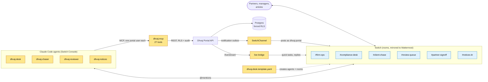

# Dhvaj Desk

**A chartered accountants' firm run from team chat.** Four Claude Code agents
and the firm's people work side by side in six [Switch](https://github.com/sandbox-quantum/switch)
rooms, one per desk, on live data from the Dhvaj Portal. People keep the pen:
anything signed, filed or sent to a client needs a person's yes.

## The problem

An Indian CA firm lives by penalty-bearing deadlines: GST every month, TDS
every quarter, ROC, PF and ESI, income-tax returns, 143(1) intimations with a
30-day reply clock, certificates that need a partner's UDIN. The Dhvaj Portal
already holds all of that work: calendars, filing runs, client documents,
reviews, notices, certificates, invoices. But the day happens in chat: "what's
pending for Sharma?", "give it to Riya", "has the client sent the sales
register?", "is October's return clean?". Today someone has to switch to the
portal for each of those, and nothing in the portal speaks up in the room
where the team is talking.

Dhvaj Desk puts the portal into the conversation:

- **Chat speaks to the portal.** Staff ask in plain words; agents answer only
  from portal data, with the link, and act through the portal's own API:
  assign filings, ask clients for documents, return a filing with review
  points, open a notice from an intimation, draft an invoice.
- **The portal speaks into chat.** A filing sent for review, a client upload,
  a new notice, a signed certificate: each lands in the right room the moment
  it happens, and @mentions the agent whose turn it is.
- **People hold the pen.** An agent drafts the chase; a person says *send*.
  The reviewer proposes; a person decides. Only a partner signs, in the
  portal. The portal's own roles and row-level security apply to every agent.

## Architecture



The highlighted (yellow) boxes were built during the hackathon; the portal
itself is earlier work (see [What was built](#what-was-built-during-the-hackathon)).

- **Agents** run on Claude Code through Switch Console. Each has its own folder
  (`agents/<name>/`, made by `npm run agents`) with a `.mcp.json` for
  dhvaj-mcp and a `CLAUDE.md`: answer only from tool results, always with the
  portal link.
- **dhvaj-mcp** (`mcp/server.mjs`) is the only way an agent touches the
  portal. Each agent signs in as **its own portal user**, so the portal decides
  what it may do, and the audit trail records every action under its name.
- **SwitchChannel** is a notification channel in the portal, beside e-mail and
  Teams. It routes each notification type to its room and @mentions the agent
  that acts on it (`task_review_requested` → dhvaj-reviewer,
  `document_uploaded` → dhvaj-chaser, `notice_received` → dhvaj-notices,
  `certificate_signed` → dhvaj-desk).
- **The live bridge** (`bridge/bridge.mjs`) follows the portal's live stream
  as each agent: a quick task given to an agent in the portal (or its phone
  app) appears in the agent's room, and the agent's reply goes back and rings
  the sender.
- **The template** (`switch/dhvaj-desk.template.yaml`) creates the four
  agents, six linked rooms and their kickoff messages in one deploy. It passes
  Switch's `template_lint`.

### How Switch is used

| Switch feature | Used for |
|---|---|
| Room template | One file creates 4 agents, 6 rooms, their links and kickoffs |
| Linked rooms | calendar → chase → review → sign-off: the desk hands work along the links |
| Agent addressing (@mentions) | The portal wakes exactly the agent whose turn it is |
| External agent (`/agents/register-other`) | The portal itself is a room member, `dhvaj-portal`, and posts as it happens |
| Mattermost bridge | The firm's people read and reply from Mattermost on desktop or phone |
| Switch Console | Runs the Claude Code agents on the firm's own machine |

Take Switch away and nothing works: there is no other place where the agents,
the portal and the people meet.

## Coverage: every desk gets a room

| Room | Agent | Portal features it uses | What happens in chat | Status |
|---|---|---|---|---|
| #firm-ops | dhvaj-desk | Dashboard summary, risk tiles (incl. KYC), My Work, stream leads, quick tasks | Morning brief: overdue by client, due this week, risk tiles. "Who has what?" "Give October GSTR-3B to Riya" → assigned, and it rings on Riya's screen | Built |
| #compliance-desk | dhvaj-desk | Compliance calendar, all 8 streams (GST, TDS, ROC, Payroll & Labour PF/ESI/PT…), filing runs | "What's pending for Sharma Traders?" overdue first; hands waiting-on-client work to the chaser | Built |
| #client-chase | dhvaj-chaser | Client dependencies, upload slots, secure upload links, filing-run reminders | Chaser drafts the reminder with an upload link; a person says *send*; the portal sends and logs it. The client uploads → the portal posts "uploaded" and the chaser closes the loop | Built |
| #review-queue | dhvaj-reviewer | To Review inbox, last-period view, checklist and required documents, review points | Compares with last period (e.g. ITC up 40% while sales rose 5%) and proposes *return with points* or *pass*; a person decides | Built |
| #partner-signoff | dhvaj-reviewer, dhvaj-desk | Sign-off requests, certificates (Form 146/15CB and others) with UDIN | Reviewer brings a five-line pack (checks INR vs FCY × rate, TDS vs DTAA article); the partner signs in the portal; "Signed: … UDIN …" posts back; the desk drafts the invoice | Built |
| #notices-itr | dhvaj-notices | Notices and their clock, 143(1)/245 intimations, ITR desk, e-verification | "143(1) for Anil Mehta, demand ₹14,350" → notice opened, reply due date posted, owner set; returns still to e-verify, reminded on a person's *send* | Built |
| #firm-ops (billing) | dhvaj-desk | Quick invoices (draft, send) | When work is lodged or signed, the desk drafts the invoice; a person issues it in the portal and approves sending | Built |
| Every room | SwitchChannel + live bridge | Notification outbox, live stream, quick-task replies | The portal posts into the right room and @mentions the right agent; quick tasks travel both ways | Built |
| #firm-ops | dhvaj-desk | Statutory audit file (PBC, review notes), payroll, people, search | Read-only answers ("which PBC items are open for Acme?") | Next step |

**What agents can never do**, enforced by the portal, not by prompts:

| Agent (portal role) | Can | Cannot |
|---|---|---|
| dhvaj-desk (manager) | read the firm's work, assign where it is the stream lead, quick tasks, draft invoices | sign, lodge, issue a UDIN |
| dhvaj-chaser (senior) | draft chases, open document requests with an upload link | mint a fresh link over an open one (manager only), send without a person's approval |
| dhvaj-reviewer (manager) | return with points, pass, request sign-off, prepare certificate packs | sign a certificate or a filing (partner only) |
| dhvaj-notices (senior) | record intimations, list deadlines, draft e-verify reminders | file a reply or an appeal |

Anything sent to a client (`chase_send`, `everify_remind`, `invoice_send`)
also refuses without `approval: {by, messageLink}` naming a person and their
message, and agents are told never to take an agent's yes.

## Run it

You need Docker, Node 20+, and [Switch Console](https://github.com/sandbox-quantum/switch)
(macOS) with Claude Code signed in.

1. **Clone both repos side by side.**
   ```sh
   git clone <this repo> dhvaj-desk
   git clone -b switch-integration <Dhvaj Portal repo> dhvaj-portal
   cd dhvaj-desk && npm install
   ```
2. **Start the portal with the demo firm.**
   ```sh
   cp .env.example .env        # demo values; DHVAJ_PORTAL_DIR points at ../dhvaj-portal
   docker compose up -d --build   # first build: about 30 min on a 4 GB / 1-CPU Docker VM
   docker compose logs -f seed # wait until it exits: story seeded, then reset to its start
   ```
   The portal is at http://localhost:3100 (sign in as `mp@dhvaj.in`,
   `partner.a@dhvaj.in` or `manager.x@dhvaj.in`), the API at
   http://localhost:3101/api/v1. Everything in it is made up.
3. **Check every tool end to end:** `npm run test:mcp` (and `npm run test:full`
   for the Full tier).
4. **Build the agents' folders:** `npm run agents`.
5. **Start Switch Console**, then deploy the template:
   `npm run deploy` (or deploy `switch/dhvaj-desk.template.yaml` in Console
   with `checkout` set to this folder). Re-deploy with `npm run deploy -- --replace`.
6. **Connect the portal to the rooms:** `npm run connect`, then
   `docker compose up -d api` so the portal picks up `.env.switch`.
   With Console's local server both commands find the server and its local
   admin login by themselves; for another server set `SWITCH_URL`,
   `SWITCH_EMAIL` and `SWITCH_PASSWORD`.
7. **Start the live bridge:** `DHVAJ_CRON_SECRET=<CRON_SECRET from .env> npm run bridge`.
8. **Open the rooms** in Console or Mattermost and try the story below.
   `npm run demo:reset` puts the story back to its start at any time.

## The demo story

1. **#firm-ops** — `@dhvaj-desk brief please`.
2. **#compliance-desk** — `@dhvaj-desk what's pending for Sharma Traders?`,
   then `give the October PF ECR to Riya`.
3. **#client-chase** — `@dhvaj-chaser ask Sharma for the October sales register`.
   Reply *send* to the draft. Open the upload link it posted and upload any
   file as the client: the portal posts "Sharma Traders uploaded: …".
4. **#review-queue** — `@dhvaj-reviewer what's waiting?` It compares
   October's GSTR-3B with September's and proposes returning it. Reply with
   your decision (*return with that point*, later *pass*).
5. **#notices-itr** — `@dhvaj-notices 143(1) for Anil Mehta, ref
   CPC/2627/A1/481920337, demand 14350, issued today` (or `npm run demo:intimation`).
6. **#partner-signoff** — `@dhvaj-reviewer prepare Acme's 15CB for the
   partner`. In the portal, as `partner.a@dhvaj.in`, approve the review and
   sign it with a UDIN on Partner A's membership number (any 18 characters
   starting `26100003`, e.g. `26100003ACMEDEMO01`): the portal posts
   "Signed: …" and the desk asks for the fee and drafts the invoice.
   `npm run demo:reset` drafts a fresh 15CB for the next run.

## Layout

| Path | What it is |
|---|---|
| `mcp/server.mjs` | dhvaj-mcp: 27 tools over the portal API |
| `mcp/smoke.mjs`, `mcp/smoke-full.mjs` | drive every tool as the agents, end to end |
| `switch/dhvaj-desk.template.yaml` | 4 agents, 6 linked rooms, kickoffs |
| `switch/deploy.mjs`, `switch/connect.mjs` | deploy the template; register `dhvaj-portal` and join it to the rooms |
| `bridge/bridge.mjs` | the portal's live stream → the agents' rooms; runs the portal's local cron |
| `seed/demo-story.mjs`, `seed/gst-3b.mjs` | the demo firm's clients, filings and agent users, made through the portal API |
| `scripts/demo-reset.mjs` | put the demo story back to its start |
| `docker-compose.yml`, `.env.example` | the portal, its database and the seed, in one command |

## What was built during the hackathon

The Dhvaj Portal (calendars, filing runs, client documents, reviews, notices,
the ITR desk, KYC, certificates, invoices, live task alerts) is earlier work.
Built for Dhvaj × Switch, Nov 5–7 2026:

- **This repo:** dhvaj-mcp and its 27 tools, the four agents' instructions,
  the Switch template, deploy and connect scripts, the live bridge, the demo
  story, the demo reset, docker compose.
- **In the portal (branch `switch-integration`):** `SwitchChannel` in the
  notification outbox (rooms by name, @mentions per notification type);
  client uploads through a secure link now notify the team; signing a
  certificate notifies the preparer and reviewer (`certificate_signed`); a
  deleted document no longer ticks its filing step; the deploy entrypoint runs
  against a local Postgres.

## Next steps

- Read-only Stretch answers: statutory audit file (PBC tracker, review
  notes), payroll, people, search.
- Monthly invoice schedules and finance reports from #firm-ops.
- Notice PDFs dropped into #notices-itr read by the portal's OCR without a
  separate upload step.

## Licence

Apache-2.0. All clients, people, PANs, GSTINs and figures in the seed data are
fictional.
